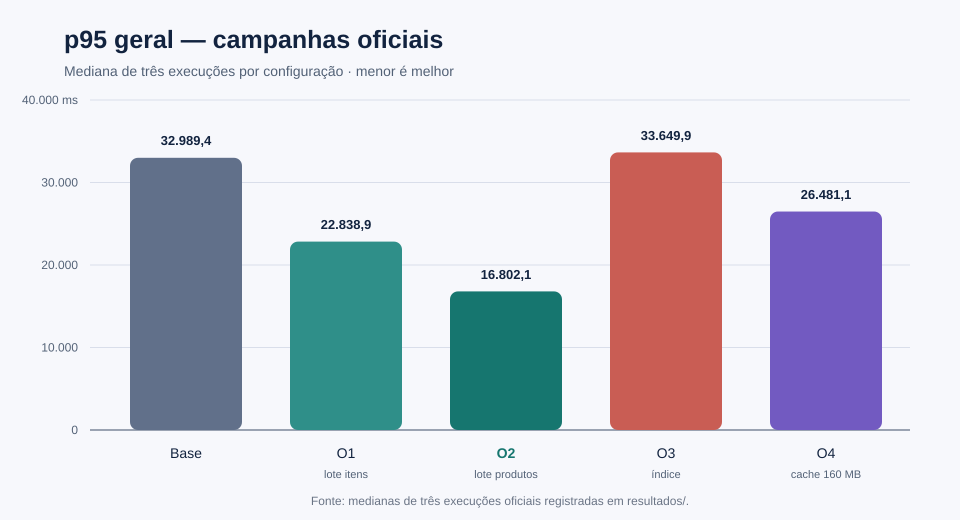

# Redução de consultas N+1 em Node.js e PostgreSQL: ganhos de desempenho sem aumento de recursos

## 1. Resumo

Esta pesquisa investigou a latência de uma API Node.js com PostgreSQL sob carga mista. O diagnóstico de `GET /clientes/:id/pedidos` identificou consultas N+1, varreduras completas e CPU do banco próxima do limite. Foram testados dois batchings, um índice B-tree e aumento de `shared_buffers`. Os batchings obtiveram o melhor desempenho na campanha original. O índice reduziu o tempo isolado da consulta de itens de 212,529 ms para 0,099 ms, mas coincidiu com aumento de 100,27% no p95 geral e queda de 35,91% na vazão. A regressão não se repetiu posteriormente; o ajuste de cache recuperou parte do desempenho.

## 2. Contexto e diagnóstico

A aplicação utiliza Node.js 20, Express, `pg` e PostgreSQL 16, com limites de 0,5 CPU/256 MiB para a API e 1 CPU/512 MiB para o banco, contendo 100 mil clientes, 500 mil pedidos e 1,5 milhão de itens. A principal lentidão investigada estava na rota `GET /clientes/:id/pedidos`, responsável por 20% da carga mista. Na linha de base, seu p95 atingiu **33.988,5 ms**, enquanto o p95 geral foi de 32.989,4 ms, com vazão de apenas 2,11 req/s.

Para identificar o gargalo, executamos três medições com `medir.sh`, analisamos o fluxo de consultas da rota e examinamos os planos SQL com `EXPLAIN (ANALYZE, BUFFERS)`, confrontando-os com as métricas de recursos. A [evidência inicial](../diagnostico/D01-clientes-pedidos/evidencias.txt) revelou **22 consultas sequenciais** no caso mediano: uma para cliente, uma para pedidos, cinco para itens e quinze para produtos. Os planos mostraram varreduras completas de 500 mil pedidos para retornar cinco registros e de 1,5 milhão de itens para retornar três. A CPU mediana do PostgreSQL atingiu 95,6324%.

A hipótese foi que o padrão N+1 multiplicava consultas e varreduras custosas, aumentando o trabalho do banco e a contenção sob concorrência. Entretanto, os tempos SQL isolados não explicavam integralmente a latência HTTP, mantendo conexões e filas como possíveis fatores adicionais.

| Operação no caso mediano | Implementação original | Após O1 e O2 |
| --- | ---: | ---: |
| Buscar cliente | 1 consulta | 1 consulta |
| Buscar pedidos | 1 consulta | 1 consulta |
| Buscar itens | 5 consultas, uma por pedido | 1 consulta em lote |
| Buscar produtos | 15 consultas, uma por item | 1 consulta em lote |
| **Total sequencial** | **22 consultas** | **4 consultas** |

## 3. Estado da arte

### Redução de N+1

O problema ocorre quando uma consulta inicial produz N entidades e o código dispara outra consulta para cada uma. Turcotte, Aldrich e Tip automatizaram esse refactoring no Reformulator e encontraram 44 pares N+1 em oito projetos JavaScript, melhorando desempenho nos casos estudados [1]. Isso não determina o ganho deste projeto, mas sustenta reduzir viagens ao banco. A EcomLabs descreve a alternativa adotada: coletar IDs e carregar relações com `WHERE ... = ANY($1)`, mantendo poucas consultas independentemente do tamanho do conjunto [2].

### Indexação

A documentação do PostgreSQL explica que índices evitam percorrer uma tabela inteira quando poucos registros satisfazem um filtro, mas exigem espaço e manutenção [3]. Para chaves estrangeiras, Albe mostra que o índice no lado referenciador não é criado automaticamente e pode ser decisivo para filtros e integridade referencial [4]. Índices não são gratuitamente benéficos: um novo caminho pode induzir um plano pior [5], competir por cache e acrescentar custo de escrita [6]. Assim, `EXPLAIN` e carga mista são complementares.

### Cache

`shared_buffers` define a memória compartilhada do PostgreSQL; a documentação recomenda tratá-lo como ponto de partida dependente da carga e lembra que o sistema operacional também mantém cache [7]. `pg_stat_io` separa contextos `normal` e `bulkread`, hits, leituras e evictions, mas não distingue uma leitura física de uma página já no cache do sistema operacional [8]. A pganalyze alerta que índices extras competem pelo buffer cache [9]. Essas fontes fundamentaram a investigação de cache, sem provar antecipadamente que mais memória melhoraria a aplicação.

## 4. Alternativas consideradas

| Abordagem | Custo | Desempenho | Risco | Esforço |
| --- | --- | --- | --- | --- |
| Redução de N+1 | Sem ampliar os limites da API (0,5 CPU/256 MiB) ou do banco (1 CPU/512 MiB); uso de lotes na API | De 22 para 4 consultas sequenciais (−81,8%). Da linha de base até O2, p95 geral de 32.989,4 para 16.802,1 ms (−49,1%) e vazão de 2,11 para 2,98 req/s (+41,2%) | Alterar ordem ou formato da resposta; as 42 respostas do contrato foram preservadas | Baixo a médio: 2 mudanças isoladas (O1 e O2) |
| Índice B-tree | Aproximadamente 21 MB para o índice, além de manutenção em escritas e competição por cache | Consulta isolada de itens de 212,529 para 0,099 ms; buffers de 9.667 para 20. Na campanha original, p95 geral de O2 para O3 subiu de 16.802,1 para 33.649,9 ms (+100,3%) | Regressão global na campanha original, não reproduzida na comparação controlada posterior | Baixo: 1 índice, 1 arquivo SQL e recriação do banco |
| Ajuste de cache | `shared_buffers` de 128 para 160 MB (+32 MB; +25%), mantendo o limite do PostgreSQL em 512 MiB | De O3 para O4, p95 geral de 33.649,9 para 26.481,1 ms (−21,3%) e vazão de 1,91 para 2,10 req/s (+9,95%) | Menor memória disponível para outros usos; reinício e variabilidade dificultam atribuir o ganho ao ajuste | Baixo: 1 parâmetro no Compose e reinício |

A redução de N+1 foi priorizada porque o caso mediano da rota D01 realizava 22 consultas sequenciais, incluindo cinco buscas de itens e quinze de produtos. As duas mudanças em lote reduziram esse total para quatro, sem ampliar os limites de recursos. A indexação foi investigada após a identificação de varreduras de 1,5 milhão de itens para retornar poucos registros. Embora tenha acelerado a consulta isolada, a primeira campanha com índice apresentou regressão global. Em comparação controlada posterior, a O3 registrou p95 geral de 28.249,7 ms, contra 33.979,6 ms da O2, sem reproduzir a regressão original. O ajuste de cache foi testado após observar o índice de aproximadamente 21 MB e a CPU elevada do banco. Cada intervenção alterou um conceito por vez. As diferenças de desempenho entre campanhas impedem atribuir causalidade definitiva, e nenhuma delas demonstrou redução do custo operacional.

## 5. Solução escolhida e por quê

A solução escolhida foi a **redução de consultas N+1 por meio de batching**, implementada em duas etapas. Na O1, os itens passaram a ser buscados em lote utilizando `ANY($1)`; na O2, a mesma estratégia foi aplicada aos produtos, com deduplicação de IDs. A montagem das respostas com `Map` preservou o contrato HTTP, incluindo campos, valores e ordem.

A abordagem reduziu de **22 para 4 consultas sequenciais (81,8%)** no caso mediano. Entre a linha de base e a O2, o p95 geral caiu de 32.989,4 para 16.802,1 ms (49,1%), enquanto a vazão aumentou de 2,11 para 2,98 req/s (41,2%), sem ampliar os limites de recursos.

A indexação apresentou ganhos expressivos na consulta isolada, mas resultados globais inconsistentes entre campanhas. O ajuste de cache melhorou a O3 original, porém não superou a O2 naquela campanha. Assim, o batching apresentou a melhor combinação observada de desempenho, baixo custo adicional e risco controlado, embora não elimine outros gargalos, como a criação de conexões por consulta.

## 6. Experimento e resultado

Cada configuração foi medida três vezes com 20 VUs, 60 s, aquecimento de 15 s e semente 42. A tabela usa a mediana das execuções; CPU e memória são a mediana das médias por execução, em ordem API/PostgreSQL.

| Exp. e hipótese | Referência | req/s | p95 geral / D01 (ms) | CPU API/PG (%) | Memória API/PG (MiB) | Conclusão |
| --- | --- | ---: | ---: | ---: | ---: | --- |
| O1: lote de itens eliminaria buscas repetidas | Base→O1 | 2,11→2,54 | 32.989,4→22.838,9 / 33.988,5→29.483,1 | 9,2014/95,6324→10,3581/94,1385 | 28,1697/394,670→29,5128/397,481 | Sustentada na direção prevista |
| O2: lote de produtos reduziria o N+1 restante | O1→O2 | 2,54→2,98 | 22.838,9→16.802,1 / 29.483,1→16.084,4 | 10,3581/94,1385→9,5231/96,9612 | 29,5128/397,481→32,6788/390,237 | Melhor campanha oficial |
| O3: índice evitaria varrer itens | O2→O3 | 2,98→1,91 | 16.802,1→33.649,9 / 16.084,4→19.494,6 | 9,5231/96,9612→10,4132/95,5431 | 32,6788/390,237→32,8816/386,854 | Sem ganho global oficial |
| O4: 160 MB de cache reduziria p95 | O3→O4 | 1,91→2,10 | 33.649,9→26.481,1 / 19.494,6→17.694,3 | 10,4132/95,5431→10,5069/95,2428 | 32,8816/386,854→32,2906/275,477 | Melhorou O3, não superou O2 |

As pastas oficiais são: [Base 1](../resultados/20261120-093234-00-linha-de-base), [2](../resultados/20261120-093458-00-linha-de-base), [3](../resultados/20261120-093707-00-linha-de-base); [O1 1](../resultados/20261120-154316-01-lote-itens-d01), [2](../resultados/20261120-154522-01-lote-itens-d01), [3](../resultados/20261120-154732-01-lote-itens-d01); [O2 1](../resultados/20261120-164142-02-lote-produtos-d01), [2](../resultados/20261120-164345-02-lote-produtos-d01), [3](../resultados/20261120-164549-02-lote-produtos-d01); [O3 1](../resultados/20261120-202706-03-indice-itens-d01), [2](../resultados/20261120-202921-03-indice-itens-d01), [3](../resultados/20261120-203133-03-indice-itens-d01); [O4 1](../resultados/20261120-225928-04-shared-buffers-160mb), [2](../resultados/20261120-230156-04-shared-buffers-160mb), [3](../resultados/20261120-230420-04-shared-buffers-160mb). Todas mantiveram o contrato. A CPU do banco continuou próxima do limite; a queda de memória em O4 não pode ser atribuída isoladamente ao cache devido ao reinício e às condições iniciais.

## 7. Limites e testes futuros

A maior limitação é a variabilidade: rotas lentas tiveram poucas amostras e houve timeouts fora de D01. Na [comparação diagnóstica posterior](../diagnostico/D01-clientes-pedidos/comparacao-cache-o2-o3.md), separada da campanha oficial, O3 superou O2: 1,52→2,31 req/s, p95 geral 33.979,6→28.249,7 ms e p95 D01 32.014,4→15.331,2 ms. Ao mesmo tempo, leituras `normal` subiram de 122 para 8.374 e evictions de 0 para 5.197. Portanto, a hipótese de que pressão adicional de cache explicou a regressão original foi enfraquecida, não definitivamente refutada.

| Campanha | Configuração | req/s | p95 geral (ms) | p95 D01 (ms) |
| --- | --- | ---: | ---: | ---: |
| Oficial original | O2 | 2,98 | 16.802,1 | 16.084,4 |
| Oficial original | O3 | 1,91 | 33.649,9 | 19.494,6 |
| Diagnóstica posterior | O2 | 1,52 | 33.979,6 | 32.014,4 |
| Diagnóstica posterior | O3 | 2,31 | 28.249,7 | 15.331,2 |

Três repetições, caches iniciais distintos, `track_io_timing=off` e métricas mistas impedem causalidade definitiva ou alegação de economia. Refutação exigiria campanha alternada mais longa, espera por etapa e estado inicial controlado. Os [próximos testes](../proximos-testes.md) registram índice em `pedidos.cliente_id`, pool, `JOIN` e Sequelize; cada alternativa requer hipótese isolada, contrato e três medições comparáveis.

## 8. Referências

1. TURCOTTE, Alexi; ALDRICH, Mark W.; TIP, Frank. *Reformulator: Automated Refactoring of the N+1 Problem in Database-Backed Applications*. 37th IEEE/ACM ASE, 2022. https://doi.org/10.1145/3551349.3556911. Acesso em: 21 nov. 2026.
2. MORALES, Luis. *The N+1 query problem: why your API runs 101 queries*. EcomLabs, 2026. https://ecomlabs.dev/blog/n-plus-one-query-problem. Acesso em: 21 nov. 2026.
3. POSTGRESQL GLOBAL DEVELOPMENT GROUP. *PostgreSQL 16: Introduction to Indexes*. https://www.postgresql.org/docs/16/indexes-intro.html. Acesso em: 21 nov. 2026.
4. ALBE, Laurenz. *Foreign Key Indexing and Performance in PostgreSQL*. CYBERTEC, 2018. https://www.cybertec-postgresql.com/en/index-your-foreign-key/. Acesso em: 21 nov. 2026.
5. ALBE, Laurenz. *Adding an index can decrease SELECT performance*. CYBERTEC, 2018. https://www.cybertec-postgresql.com/en/index-decreases-select-performance/. Acesso em: 21 nov. 2026.
6. AUGUSTINE, Jobin. *PostgreSQL Indexes Can Hurt Performance: Exploring the Negative Effects and the Costs Involved*. Percona, 2024. https://www.percona.com/blog/postgresql-indexes-can-hurt-you-negative-effects-and-the-costs-involved/. Acesso em: 21 nov. 2026.
7. POSTGRESQL GLOBAL DEVELOPMENT GROUP. *PostgreSQL 16: Resource Consumption*. https://www.postgresql.org/docs/16/runtime-config-resource.html. Acesso em: 21 nov. 2026.
8. POSTGRESQL GLOBAL DEVELOPMENT GROUP. *PostgreSQL 16: The Cumulative Statistics System*. https://www.postgresql.org/docs/16/monitoring-stats.html. Acesso em: 21 nov. 2026.
9. PGANALYZE. *Index Advisor: Getting Started*. https://pganalyze.com/docs/index-advisor/getting-started. Acesso em: 21 nov. 2026.

## 9. Uso de IA

O Codex (GPT-5.6 Sol) auxiliou na inspeção do código, execução controlada dos diagnósticos e experimentos autorizados, cálculo das medianas e organização das tabelas.
O ChatGPT foi utilizado como ferramenta de pesquisa por artigos e documentação; as afirmações foram confrontadas com arquivos versionados, saídas do `medir.sh`, planos SQL e fontes abertas, além das verificações automatizadas de contrato e Git.
Toda saída foi criticamente verificada pela autora, mediante conferência do código, das fontes e das evidências experimentais.
